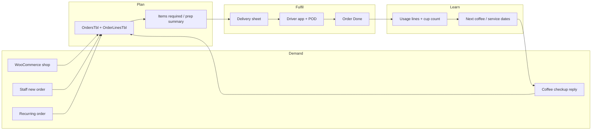

# 01 — Executive System Summary

**Source system:** QOnT (Quaffee Order Tracker), ASP.NET Web Forms on .NET Framework 4.8  
**Codebase:** `TrackerSQL` (assembly version in `Web.config` appSetting `Version`, currently **3.0.4.3**)  
**Live hosts (from `Documentation/PROJECT_OVERVIEW.md`):** `https://tracker.quaffee.co.za`, also `https://quaffeetracker.co.za`  
**Database:** SQL Server catalog **`OtterDb`**, connection name `TrackerDataSQL`  
**Business timezone:** `South Africa Standard Time` (`AppTimeZoneId`, `Classes/TimeZoneUtils.cs`)  
**Target replacement:** RainbowOF (Rainbow Order & Fulfillment) on .NET 10, Blazor, MudBlazor, EF Core  

This document onboards a team that has never seen QOnT. It describes what the production system does. It is not a line-by-line code map; later documents cite pages, classes, and tables.

---

## 1. Purpose

QOnT is the operational system of a South African speciality-coffee roaster (Quaffee). It is the system of record for:

- who the customer is and how they are served
- what they usually buy, how fast they consume it, and when they will next need it
- orders (one-off, recurring, and website)
- roasting / packing preparation and the day’s delivery run
- proof that a delivery happened
- coffee-machine repairs and service cadence
- reminder emails that ask the customer to confirm the next delivery before stock runs out

It is **not** a full accounting system. Order lines store item, quantity, preparation type, and packaging (`Models/OrderLine.cs`). There is no unit price or tax on the line. “Invoiced” is an operational flag (`OrdersTbl.InvoiceDone`, `OrderManager.MarkItemAsInvoiced`). Accounting data (VAT number, payment terms, price-level factor, credit limit) lives on `ContactsAccInfoTbl` and is maintained for the customer record and for a QuickBooks merge tool (`Tools/MergeCustomersFromQB.aspx`). **Assumption:** invoices and stock valuation are produced outside QOnT (QuickBooks and/or the roastery). Human verification required before RainbowOF treats billing as in-scope ledger functionality.

The product name in the staff UI is **QOnT** (`Site.Master`). The customer-facing portal is branded **My Quaffee** (`Portal/Portal.Master`). The driver companion is **Quaffee Driver** (separate Vue/Capacitor app calling `/api/v1`; see `Documentation/MOBILE_API_AND_DRIVER_APP.md`).

---

## 2. Core business functions

| Function | What the business gets |
|---|---|
| Contact management | One record per customer site: company, people, phones, emails, delivery area, equipment, preferences, account flags |
| Consumption prediction | After each completed delivery, cup-count and stock-on-hand update the date the customer will next need coffee, a clean, a filter, a descale, and a service |
| Coffee checkup | A batch email that offers the predicted next order and lets the customer accept, change, go away, or stop reminders |
| Order capture | Staff orders, recurring standing orders, and WooCommerce website orders, all landing in the same order header + lines |
| Preparation | What must be roasted, packed, and loaded for a delivery date, grouped for the roastery |
| Delivery execution | Sheet by driver and area, route order, GPS, proof of delivery (name, signature, short quantities), waybill for couriers |
| Order completion | Marks the order done, writes usage history, rolls item groups, recalculates predictions, sends status email |
| Repairs | Job cards for machines, status emails, optional linked order |
| Customer self-service | Portal: my details, orders, recurring orders, repairs, proof PDFs |
| Driver mobility | Offline delivery capture and repair updates via REST |

---

## 3. Main user groups

Authorisation is ASP.NET Membership + Roles (`Web.config`: `AspNetSqlMembershipProvider`, `AspNetSqlRoleProvider`). The site denies anonymous users and allows roles **Administrators**, **Agent Manager**, **Agents**, **Repair**.

| Group | How they appear in code | What they do |
|---|---|---|
| Administrators | Role `Administrators` or `Administrator`. Username `warren` is also treated as admin (`SystemConstants.UserConstants.AdminUserName`, `Managers/SecurityManager.cs`) | Full staff app, user admin, WooCommerce, GPS, driver-app settings, API device revoke |
| Agent Manager | Role string varies: menu/config says `Agent Manager`; `Tools/SystemTools.aspx.cs` also checks `AgentManager` | **Suspected:** senior operations. Confirm the live role name in `aspnet_Roles` |
| Agents | Role `Agents` | Day-to-day contacts, orders, prep, deliveries |
| Repair | Role `Repair` (also checked lower-case `"repair"` in `Pages/CustomerDetails.aspx.cs`) | Repair screens. A user whose **only** role is repair is restricted on customer details |
| Contact | Role `Contact` (`ContactPortalSchemaInstaller.ContactRoleName`) | My Quaffee portal only. Linked by `ContactUserLinkTbl` |
| Drivers | Membership user whose `PeopleTbl.SecurityUsername` matches, or an admin (`MobileAuthManager`) | Quaffee Driver app, bearer token, not the website cookie |
| Customers without a login | Public token links | Disable reminders (`DisableClient.aspx`), view an order (`Pages/ViewMyOrder.aspx` via `PublicOrderViewManager`) |

**Assumption:** there is no fine-grained permission table. Access is role name plus a few hardcoded admin checks. RainbowOF should replace this with explicit permissions (see `docs/07-security.md`).

---

## 4. High-level workflows

1. **Know the customer.** Contacts (`Pages/Contacts.aspx`, `Pages/ContactDetails.aspx`) hold delivery area, preferred agent, equipment serial, primary and secondary item, packaging, and flags such as `AutoFulfill`, `PredictionDisabled`, `AlwaysSendChkUp`, `RequiresPurchOrder` (the last on account info).
2. **Predict need.** `PredictionManager` writes `ContactsUsage` next-coffee, next-clean, next-filter, next-descale, and next-service dates from rolling usage (max 6 samples, `BusinessConstants.MaxRollingAverageValues`).
3. **Ask before roasting.** `CoffeeCheckupManager` prepares customers whose next date falls in a window (default 9 days, bounds 5–30) and emails them. Away customers and internal customers are skipped. Reminder count is capped (`CustomerConstants.MaxReminders = 10`).
4. **Take the order.** `Pages/OrderDetail.aspx` (new and edit). Duplicate detection is by contact + required date (`OrderManager.FindExistingOrderForHeader`). Walk-in orders use customer id **9**, name prefix `ZZ` (`SundryCustomerID`).
5. **Prepare.** `Pages/ItemsRequired.aspx`, `Pages/PreperationSummary.aspx`, `Pages/SummaryOFCoffeeRequired.aspx`.
6. **Deliver.** `Pages/DeliverySheet.aspx` plus Quaffee Driver (`/api/v1/delivery`). Courier and parcel people require a waybill when tracking is required (`OrderDoneManager.RequiresTrackingNumber`).
7. **Close the loop.** `Pages/OrderDone.aspx` records stock still on hand and machine cup count, posts usage, advances item-group rotation, recalculates predictions, and emails the customer.

Repairs run beside this loop: a repair can create or sync a related order (`RepairManager.EnsureRelatedOrder`).

---

## 5. Major modules

Staff navigation is the menu in `Site.Master`.

| Menu | Pages | Module |
|---|---|---|
| Home | `Default.aspx` | Dashboard of the same links |
| Contacts | `Pages/Contacts.aspx`, `ContactDetails.aspx`, `ContactsAway.aspx`, `SendCoffeeCheckup.aspx`, `SendClientMail.aspx`, `SentRemindersSheet.aspx` | CRM, absence, demand emails |
| Orders | `OrderDetail.aspx?NewOrder=true`, `OrderEntry.aspx`, `RecurringOrders.aspx`, `Tools/WooOrderImport.aspx` | Order capture |
| Repairs | `Pages/Repairs.aspx`, `RepairDetail.aspx` | Service jobs |
| Preperation | `ItemsRequired.aspx`, `DeliverySheet.aspx`, `PreperationSummary.aspx` | Roast / pack / load (spelling is legacy) |
| Deliveries | `Tools/Deliveries.aspx` hub, driver tracking, delivery order, driver app, awaiting-done, customer locations, area and holiday settings | Last mile |
| System | Item groups, lookups, logs, system tools, messages, preferences, Woo mapping, email diagnostics, leave form | Master data and admin |
| User | Login, password, `Administration/ManageUsers.aspx`, `ManageRoles.aspx` | Identity |

Customer portal (`Portal/`): Home, My Details, My Orders, My Repairs, My Recurring Orders.

Public and semi-public: `Account/Login.aspx`, `DisableClient.aspx`, `Pages/ViewMyOrder.aspx`, `Handlers/ProofOfDelivery.ashx`.

Inter-site transfer pages still exist: `Pages/OrderVineyard2Buiten.aspx`, `Pages/OrderBuiten2Vineyard.aspx`. **Suspected:** two physical sites (Vineyard and Buitenverwachting or similar). Confirm whether they are still used.

---

## 6. Key integrations

| Integration | Mechanism | Business role |
|---|---|---|
| WooCommerce | `Managers/WooCommerceApiClient*.cs`, settings in `WooCommerceSettingsTbl`, import `Tools/WooOrderImport.aspx`, mapping `Tools/WooCommerceMapping.aspx` | Website orders and customers become QOnT orders. Attribute maps set quantity, packaging, or notes. Shipping method maps to area and delivery person. Payment method is mapped. Category filter limits what is imported |
| Quaffee Lovers | `QuaffeeLoversMembershipManager`, `QuaffeeLoversGrantTbl`, `Tools/QuaffeeLoversInvite.aspx` | Membership: invite, grant, set Woo role `member` |
| Email | MailKit (`Classes/EmailMailKitCls.cs`), Office 365 SMTP, from `orders@quaffee.co.za` | Checkups, order status, POD, recurring-order changes, client campaigns, goodbye on self-disable. `EmailTestMode` redirects mail in non-production |
| Quaffee Driver | `/api/v1` Web API 2, bearer tokens in `MobileDeviceTokensTbl` | Deliveries, proofs, repairs, GPS pings, APK download |
| GPS / routing | `CustomerLocationTbl`, `DriverLocationPingTbl`, `RoadLegTbl`, `Classes/Geo/RoutePlanner.cs`, depot in system preferences | Stop order and “left the depot” |
| QuickBooks | `Tools/MergeCustomersFromQB.aspx` | Match and merge customer master data. Not a live API in the pages reviewed |
| South African postcodes | `SaPostalCodeTbl`, `Tools/PostalAreaSetup.aspx`, `Tools/ContactPostalFill.aspx` | Map postal codes to delivery areas |
| Proof PDF | `Classes/SimplePdf.cs`, `ProofOfDeliveryManager` | Customer and staff proof of delivery |
| Legacy Access | `DisableAccessDb=true` | Migration from Access is complete for runtime. Do not revive OleDb |

Schema changes for newer features are applied by XML command files under `App_Data` (`SQLCommands-*.xml`, copies in `App_Data/GoLive/`) run by `XmlSchemaCommandRunner` and `*SchemaInstaller` classes. There is **no stored-procedure layer** in this codebase.

---

## 7. Major business capabilities that must survive

RainbowOF must keep these capabilities even when the coffee vocabulary is generalised (see `docs/08-domain-modernisation.md`):

1. Customer sites with a service relationship type, not just a name and address.
2. Standing product preferences (primary and secondary item, qty, prep, pack) used to prefill orders and reminders.
3. A consumption model that forecasts the next replenishment and the next maintenance events from actual usage, adjusted for holidays and “customer is away”.
4. A proactive replenishment email with a response path (order, change, away, stop).
5. One order document that can come from staff, a standing order, the website, or a customer reply, and that can be merged or moved between dates.
6. Duplicate protection: same customer and same required date.
7. Walk-in / cash / one-off orders that are not a real account (today: contact 9, `ZZName`).
8. Delivery-on-behalf: one account, many ship-to addresses with their own GPS (`ContactDeliverToAddressTbl`, `DeliveryOnBehalf`).
9. Area calendar: which weekday an area is prepared, how many days later it is delivered, and what the website promised the customer (`AreaPrepDaysTbl`, `DeliveryPromiseRuleTbl`).
10. Preparation quantities for the production team, separate from the driver sheet.
11. A driver run: sequence, outcome, received-by, signature, short-supply quantities, office note.
12. Courier waybills with format checks and duplicate warnings (`OrderWaybillTbl`, `CourierServicesTbl`).
13. Closing a delivery writes history and moves the forecast forward. Closing also rotates “group items” (a cycle of products, `ItemGroupsTbl` / `UsedItemGroupsTbl`).
14. Repairs with statuses that can email the customer and that can hang off an order.
15. Customer login scoped to one contact, including their proofs.
16. Self-service “stop emailing me”, with an admin alert and a choice of reminders-only versus full disable (`DisableClientManager`).
17. Audit of contact changes (`ContactChangeLogTbl`) and an application log (`LogTbl`, `Tools/LogViewer.aspx`).
18. Holiday closures that shift promised and predicted dates (`HolidayClosuresTbl`).
19. Purchase-order required warning (`UIConstants.PORequiredText`) for accounts that need a PO before fulfilment.
20. Multi-channel identity: website customer id (`WooContactInfoTbl`, `WooOrderInfoTbl`) stays linked after import.

---

## 8. What the system deliberately does not do

State these so RainbowOF does not invent scope by accident:

- No warehouse stock ledger with on-hand, reserved, and bin locations was found. “Stock” on Order Done is **customer stock still on the machine or shelf**, converted to cups (`OrderDoneManager`: kilograms × 100 cups, `BusinessConstants.TypicalCupsPerKg = 100`).
- No purchasing / supplier orders module was found, other than inter-site transfer pages and a collection-from-supplier concept in later driver work (changelog: supplier collections). **Verify** `ContactTypesTbl.DriverCollectionOnly` and People “Collections” before designing purchasing.
- No price on the order line. `PriceLevelsTbl.PricingFactor` is a customer attribute.
- No general ledger, tax invoice PDF, or statement run inside QOnT.
- No multi-company tenancy. One roaster, one database, South African calendar and postcodes.

---

## 9. Reading order for the new team

1. This file.
2. `docs/02-functional-inventory.md` — every capability.
3. `docs/03-workflows.md` — how a day actually runs.
4. `docs/04-business-rules.md` — rules that must be reimplemented or consciously dropped.
5. `docs/05-database-analysis.md` — tables.
6. `docs/08-domain-modernisation.md` and `docs/09-rainbowof-specification.md` — what to build.
7. `docs/10`–`docs/12` — UI, architecture, sequence.

Existing internal notes under `Documentation/` are useful history (Access rename, repository rules, Woo plan, mobile API). Where they disagree with current models (for example `Documentation/TABLE_SCHEMA_REFERENCE.md` still describes a shorter `ContactsTbl`), **trust the C# models and repositories**. That schema document was written for the Access-to-SQL rename and is incomplete for columns added since.
