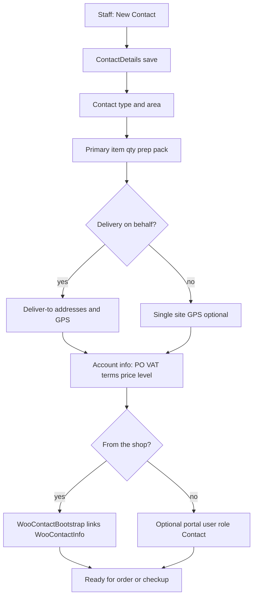
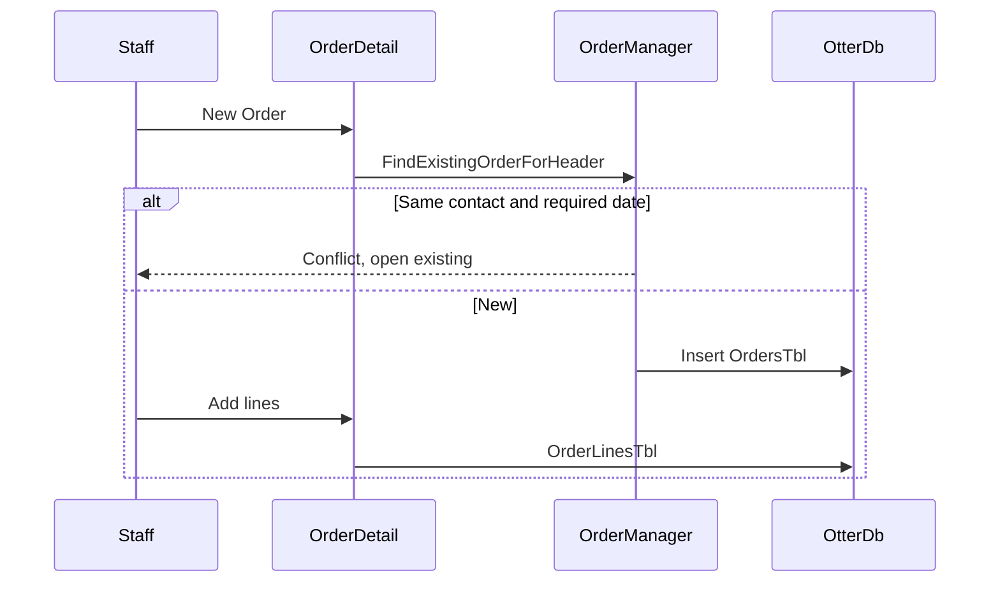
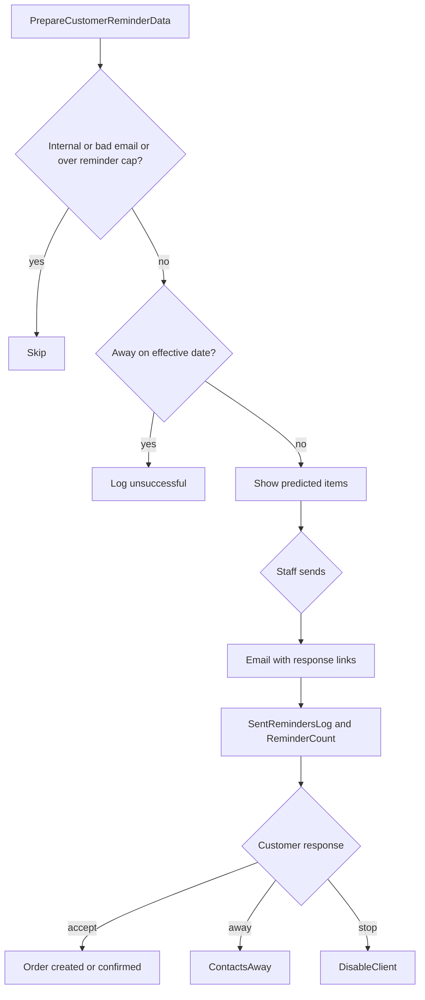
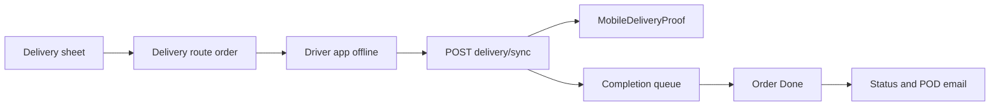
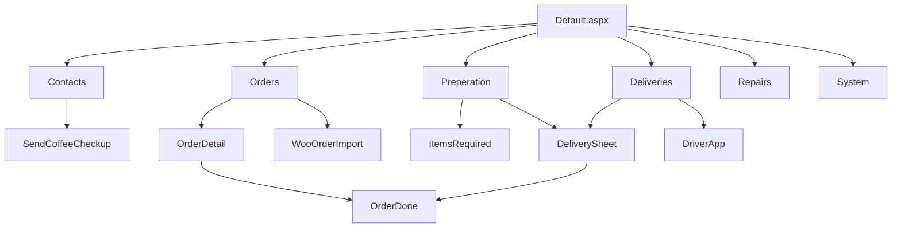

# 03 — Pages and Workflows

Base URL in production is the tracker host. Paths below are application-relative. Anonymous access is denied except where `Web.config` `<location>` allows it (`Account/Login.aspx` is explicitly open; password recovery and `DisableClient.aspx` must be confirmed in the rest of `Web.config` — **verify** `location` entries for `DisableClient.aspx`, `Portal/Login.aspx`, `api`, and `driver`).

Staff chrome: `Site.Master` (desktop menu, mobile hamburger, bottom tab bar: Home, Deliver, Order, Contacts, Checkup). Portal chrome: `Portal/Portal.Master`. Print chrome: `Print.master`.

---

## 1. Page catalogue

### 1.1 Staff — daily

| URL | Purpose | How users arrive | Main actions | Validation and rules | Output |
|---|---|---|---|---|---|
| `/Default.aspx` | Dashboard | Menu home icon | Navigate | Authenticated staff role | None |
| `/Pages/Contacts.aspx` | Find customers | Menu Contacts | Search, open, start order | Role gate | Screen |
| `/Pages/ContactDetails.aspx` | Create or edit customer | Menu New Contact; from list | Save profile, preferences, flags | Email format where the page checks it; contact type and area are lookups | `ContactsTbl` |
| `/Pages/ContactsAway.aspx` | List absences | Menu | Open a period | — | Screen |
| `/Pages/ContactsAwayDetail.aspx` | Edit one absence | From away list | Save dates and reason | End on or after start (**verify** on page) | `ContactsAwayPeriodTbl`, confirmation email |
| `/Pages/SendCoffeeCheckup.aspx` | Due-customer mail run | Menu, mobile tab | Prepare list, exclude one, send, edit texts | Eligibility in `CoffeeCheckupManager.ValidateCustomerEligibility` | Email, `SentRemindersLogTbl` |
| `/Pages/LoadSendCoffeeCheckup.aspx` | Loader for the checkup working set | From checkup | Build temp rows | Window days | Temp checkup tables |
| `/Pages/SendClientMail.aspx` | One-off campaign | Menu | Filter, preview, send | Valid email | `ClientMailSendLogTbl` |
| `/Pages/SentRemindersSheet.aspx` | Who was reminded | Menu | Filter, read | — | Screen, print |
| `/Pages/OrderDetail.aspx` | Order header and lines | Menu New Order (`?NewOrder=true`); from order list; `?` ids | Add lines, save, duplicate check, open done | Duplicate contact+date; qty ≤ 0 stored as 1 (`FormatConstants.OrderLineQtyAtLeastOne`); PO warning text | `OrdersTbl`, `OrderLinesTbl` |
| `/Pages/OrderEntry.aspx` | Order search | Menu View/Edit | Open, filter by date and customer | — | Screen |
| `/Pages/OrderDone.aspx` | Close a delivery | From order or delivery sheet | Enter stock kg, cup count, status, waybill | Waybill required for dispatch people when setting says so; duplicate waybill warning; format warning | Usage, predictions, email, `Done` |
| `/Pages/RecurringOrders.aspx` | Standing orders | Menu | Enable, disable, open | Notify contact on change | `RecurringOrdersTbl` |
| `/Pages/RecurringOrderDetails.aspx` | One standing order | From list | Edit lines and person | Same line rules as orders | Items table, email |
| `/Pages/ItemsRequired.aspx` | Production list | Menu, mobile | Pick date, print | Open lines for that prep | Print |
| `/Pages/PreperationSummary.aspx` | Pack summary | Menu | Pick date, print | — | Print |
| `/Pages/SummaryOFCoffeeRequired.aspx` | Coffee batch total | From prep (link) | Read | — | Print |
| `/Pages/DeliverySheet.aspx` | Run sheet | Menu, mobile Deliver tab | Date, driver, print, jump to order | — | Print, flags |
| `/Pages/Repairs.aspx` | Job list | Menu | Filter status and date | — | Screen |
| `/Pages/RepairDetail.aspx` | Job card | Menu New Repair; from list | Save, status, ensure related order | Sundry name required when contact is ZZ (`RepairManager.ValidateSundryContactName`) | `RepairsTbl`, maybe `OrdersTbl` |
| `/Pages/RepairStatusChange.aspx` | Fast status change | From list | Set status | Status may email the contact | Email |

### 1.2 Staff — deliveries and places

| URL | Purpose | Actions | Integrations |
|---|---|---|---|
| `/Tools/Deliveries.aspx` | Hub for last-mile tools | Navigate | — |
| `/Tools/DriverTracking.aspx` | Live or historical map | Filter person and day | `DriverTrackingData.ashx`, GPS pings |
| `/Tools/DeliveryOrder.aspx` | Stop sequence | Reorder | `DeliveryRouteTbl` |
| `/Tools/DriverApp.aspx` | App settings and APK | Save settings, download | `/api/v1/app` |
| `/Tools/DeliveriesAwaitingDone.aspx` | App deliveries not closed | Complete now; `?OrderID=` highlights | Order Done |
| `/Tools/CustomerLocations.aspx` | Map of customers | Edit GPS | Admin |
| `/Tools/DepotLocation.aspx` | Depot pin | Save lat/long | Route planner |
| `/Tools/DeliveryPromiseRules.aspx` | Website SLA rules | CRUD rules | Admin |
| `/Tools/HolidayClosures.aspx` | Closed dates | CRUD | Prediction and promise |
| `/Tools/HolidayClosureDetail.aspx` | One closure | Save | — |
| `/Tools/MoveDeliveryDate.aspx` | Shift many orders | Old date, new date | Orders |
| `/Pages/ContactLocation.aspx` | One customer pin / deliver-to | Save | GPS |
| `/Pages/Lookups.aspx` | All catalogues | `?tab=Areas`, `Delivery Days`, `People`, `Couriers`, `Delivery Outcomes`, `Packaging`, etc. | — |

### 1.3 Staff — channel, system, identity

| URL | Purpose | Role gate in code | Integrations |
|---|---|---|---|
| `/Tools/WooOrderImport.aspx` | Import shop orders | Admin | Woo REST |
| `/Tools/WooCommerceMapping.aspx` | Maps | Admin | Woo catalogue cache |
| `/Tools/SystemPreferences.aspx` | Settings (`?section=gps`) | Admin | Woo keys, GPS |
| `/Tools/QuaffeeLoversInvite.aspx` | Member invite | Admin | Woo role, email |
| `/Tools/PostalAreaSetup.aspx` | Postal → area | Admin | `SaPostalCodeTbl` |
| `/Tools/ContactPostalFill.aspx` | Fill missing postals | Admin | Contacts |
| `/Tools/MergeCustomersFromQB.aspx` | QB customer merge | Admin (assumed; confirm page) | File or paste from QuickBooks |
| `/Tools/MessagesEditor.aspx` | Wording | Admin via tools | Email bodies |
| `/Tools/EmailDiagnostics.aspx` | SMTP | Admin | Office 365 |
| `/Tools/LogViewer.aspx` | Errors | Staff | `LogTbl` |
| `/Tools/SystemTools.aspx` | Tool index | Admin or Agent Manager | — |
| `/Tools/DatabaseBackup.aspx` | Backup | Admin | SQL backup |
| `/Tools/XMLtoSQL.aspx` | Apply schema XML | Admin | DDL batches |
| `/Tools/ApiTester.aspx` | API console | Admin | `/api/v1` |
| `/Tools/SqlConnectionTest.aspx` | DB ping | Admin | SQL |
| `/Pages/ItemGroups.aspx` | Rotation groups | Staff | Items |
| `/Pages/GroupItemDetail.aspx` | One group | Staff | — |
| `/Pages/LeaveApp.aspx` | Leave form | Staff | Email or print (**verify**) |
| `/Account/Login.aspx` | Sign in | Public | Membership |
| `/Account/ChangePassword.aspx` | Password | Staff | Membership |
| `/Account/RecoverPassword.aspx` | Reset | Public if location allows | Email |
| `/Account/Register.aspx` | Register | **Verify** it is not open on production | Membership |
| `/Administration/ManageUsers.aspx` | Users | Admin | Membership |
| `/Administration/ManageRoles.aspx` | Roles | Admin | Roles |
| `/Administration/UserInformation.aspx` | One user `?user=` | Admin | Roles |
| `/Administration/ResetPasswordHelper.aspx` | Reset | Admin | Membership |

### 1.4 Customer and public

| URL | Purpose | Actions |
|---|---|---|
| `/Portal/Login.aspx` | Contact sign-in | Login |
| `/Portal/Home.aspx` | Portal home | Navigate |
| `/Portal/MyContact.aspx` | Profile | Request change |
| `/Portal/MyOrders.aspx` | Order list | Open |
| `/Portal/MyOrder.aspx` | One order | View lines, POD |
| `/Portal/RepeatOrder.aspx` | Repeat | Submit repeat (**verify** effect) |
| `/Portal/MyRecurring.aspx` | Standing orders | View |
| `/Portal/MyRecurringDetail.aspx` | One standing order | View |
| `/Portal/MyRepairs.aspx` | Repairs | View |
| `/Portal/MyRepair.aspx` | One repair | View |
| `/Portal/ChangePassword.aspx` | Password | Save |
| `/Portal/ViewAs.aspx` | Impersonate | Staff views as contact |
| `/Pages/ViewMyOrder.aspx` | Token order view | Read |
| `/DisableClient.aspx` | Stop service or reminders | Confirm choice |
| `/Handlers/ProofOfDelivery.ashx?id=` | POD PDF | Download |
| `/api/v1/...` | Driver API | See section 4 |
| `/driver/` | Driver web shell | Quaffee Driver static app |

### 1.5 Legacy, print, and dev — do not redesign as first-class RainbowOF screens

| URL | Note |
|---|---|
| `/Pages/NewOrder.aspx`, `/Pages/NewOrderDetail.aspx`, `/Pages/OrdersEdit.aspx`, `/Pages/DeleteOrderLine.aspx` | Older order editors. Current menu uses `OrderDetail.aspx` |
| `/Pages/CustomerDetails.aspx` | Older contact editor with repair-only restriction |
| `/Pages/RepairDetailOld.aspx` | Superseded by `RepairDetail.aspx` |
| `/Pages/ClientList.aspx`, `/Pages/ContactsTest.aspx`, `/Pages/TestPage.aspx` | Test or retired lists |
| `/Pages/OrderSheet.aspx`, `/Pages/Print.aspx` | Print layouts |
| `/Pages/QuaffeeCoffeeTastingSheet.aspx` | Tasting form. Coffee-specific; keep only if the business still uses it |
| `/Pages/OrderVineyard2Buiten.aspx`, `/Pages/OrderBuiten2Vineyard.aspx` | Site-to-site move |
| `/Pages/ThisWeeksOrder.aspx` | **Suspected** weekly board. Verify |
| `/Pages/SupportTables.aspx`, `/Pages/LogTable.aspx` | Admin grids |
| `/test/*`, `/Tools/AutoClassMaker.aspx`, `/Tools/TestPeople.aspx`, `/smpttester/` | Developer utilities |
| `/HttpErrorPage.aspx` | Custom error (live `RemoteOnly`) |

---

## 2. End-to-end workflows

### 2.1 Customer onboarding

1. Staff opens `ContactDetails`. Company name is the operational key shown everywhere.
2. Contact type (constants in `SystemConstants.CustomerTypeConstants`) sets the commercial relationship: coffee and maintenance, service contract, coffee only, rental, outright purchase, service only, other, green coffee only, information only. These ids are seed data. **Verify** descriptions in `ContactTypesTbl` still match the constants.
3. Area selects the prep weekday and the delivery delay (`AreaPrepDaysTbl`).
4. Preferred agent (`PeopleTbl`) is who normally delivers. Sales agent defaults to Quaffee (`Q`).
5. Primary preference is the item the checkup and “last order” logic start from. Secondary is optional (`TypicallySecToo`).
6. If the account needs a customer PO, `ContactsAccInfo.RequiresPurchOrder` makes the order UI show `!!!PO required!!!`.
7. Woo import can create the same shape via `WooContactBootstrap` when a shop customer is unknown.
8. Portal access is a membership user in role `Contact` plus `ContactUserLinkTbl`. It is not created for every contact.

**Human verification:** whether a new contact is predicted immediately or only after the first Order Done (install date from `ContactUsageLinesRepository.GetInstallDate`).

### 2.2 Staff order

Actions on the order: add or delete line, change date (`MoveOrderDeliveryDate`), move a line to another order, mark invoiced, go to Order Done, email status (`OrderDoneManager.SendOrderStatusEmail`).

Walk-in: contact id 9. The real recipient is parsed from notes by `Classes/SundryNotes.cs` (name before `:`, `[#email#]`). Header may store `WalkInAreaID` and walk-in coordinates so the pin is not contact 9’s pin.

Delivery on behalf: header `DeliverToAddressID` points at `ContactDeliverToAddressTbl`.

Invoice type (`InvoiceTypesTbl`) is a fulfilment flag (standard, delivery note, dispatch note, gift — comment on `Order.InvoiceTypeID`), rendered as a pill on the delivery sheet. It is copied from the recurring order when a standing order creates a delivery.

### 2.3 Website order (Woo)

1. Admin has maps: category filter, item map, attribute role (qty, packaging, both, notes), shipping method → area and person, postal area, payment method, packaging/service type.
2. Staff opens Woo Order Import, or new-order checks Woo when that setting is on.
3. `WooCommerceOrderImportManager` reads orders, skips ids already in `WooOrderInfoTbl`, resolves the contact (`WooContactInfoTbl` or bootstrap), writes header and lines.
4. Address helper (`WooImportAddressHelper`) fills deliver-to or contact address.
5. Promised date comes from `DeliveryPromiseManager` (area + time window). Operational required date should follow the area prep calendar. **Verify** which date the importer writes into `RequiredByDate` when the promise and the next prep day differ.
6. Payment is not captured. The map is informational.

### 2.4 Recurring order to a real order

1. Staff defines the basket and enables it.
2. Contact is emailed (`RecurringOrderNotificationManager`) using `MessageKeys` recurring texts.
3. A generator (page or order-close path — **verify** the method that inserts) creates `OrdersTbl` for the next cycle if one does not already exist for that date.
4. Coffee checkup suppresses customers whose recurring cycle is shorter than `CoffeeCheckupMinMonthlyRecurringDays` (20) so they are not double-asked.
5. Customer can view the standing order in the portal. Disabling from the disable-client “all” path does **not** automatically disable recurring orders; admin mail says manual action is required.

### 2.5 Coffee checkup (demand)

Window: `CoffeeCheckupReminderWindowDays` default 9, clamped by min 5 and max 30. Date matrix can be cached (`CoffeeCheckupDateMatrixTTLMinutes`) and optionally built in SQL (`CoffeeCheckupUseSqlMatrix`, currently false). Holiday inside the window is detected (`IsHolidayComingInWindow`).

**Verify** the exact customer reply URL and whether “yes” creates the order immediately or only flags the row for staff. The message keys and `OrderManager.ProcessSKUParameters` show the email can deep-link an order with SKUs.

### 2.6 Preparation day

1. Area prep day says “this weekday we prepare area X, deliver N days later”.
2. Items Required and Preparation Summary list open lines for that prep date: item, prep type (roast profile / service), packaging, qty, customer.
3. Summary of coffee required collapses to production batches.
4. Item group lines show the current group member, not the group header.
5. Staff print (`Print.master`). There is no separate pick-file format.

### 2.7 Delivery day

1. Office prints or opens the sheet. Flags: PO required, invoice-type pill, recurring origin (order flags, `OrderFlagsSchemaInstaller`), not yet done.
2. Stop order: driver’s saved order (`POST delivery/route` → `DeliveryRouteTbl`), else learned or GPS order (`RoutePlanner`, depot, speed and service minutes in API settings).
3. Driver captures outcome from `MobileDeliveryOptionsTbl` (needs received-by name, or “not at client”), signature, terms tick, short quantities per line, optional note to office.
4. Sync is idempotent on `clientRef`.
5. If auto-complete is on, the queue runs Order Done as the driver. If off, the order appears on Deliveries Awaiting Done until the office enters cup count.
6. Courier drops require a tracking number. Format is checked against `CourierServicesTbl` patterns. Duplicates warn with the other customer’s name and date.
7. POD PDF is emailed and stored. Portal users download only their own (`ContactPortalManager.CanViewProof`).

GPS: pings stored only inside the tracking window (weekdays and hours in settings). First ping of the day more than 300 m from the depot is logged as “started” (mobile API doc).

### 2.8 Order Done and the forecast

1. Staff (or the queue) sends stock kilograms still at the customer and the machine cup count.
2. Cup count is reduced by stock × 100 (`TypicalCupsPerKg`) so leftover beans are not treated as consumed (`OrderDoneManager.AddItemsToUsageTables`).
3. Lines are written to usage tables. Group items advance (`UsedItemGroupsTbl`) so the next order uses the next group member. The UI text is `LastOrderGroupNote`.
4. `PredictionManager.UpdatePredictions`: if there is an install date, `CalcAndSaveNextRequiredDates` walks `TrackedServiceItemsTbl`. Items flagged `ThisItemSetsDailyAverage` (coffee) compute daily rate from up to 6 usage points against a typical average. Later items (clean, filter, descale, service) schedule `lastQty * itemAverage / dailyAverage` days ahead, or use delivery cadence when available, then `AddHolidayExtension`.
5. If there is no install date, a fallback writes next coffee = today + 20 days and the constant averages.
6. `PredictionDisabled` on the contact must be honoured. **Verify** the repository filter so a disabled contact is not bulk-recalculated.
7. Status email uses the contact’s `SendDeliveryConfirmation` and the status key. Waybill emails include the courier tracking URL.

Bulk recalc exists for stale forecasts (`RecalculateBulk`) and does **not** rebuild recurring orders.

### 2.9 Returns and failed delivery

There is no returns document. Failed delivery is an outcome on the proof (“not at client” / not delivered) plus order notes. Short delivery is per-line quantity on the proof (`MissingItems`). **RainbowOF decision:** model these as fulfilment exceptions, not as a retail returns module, unless the business confirms they take goods back into stock. Nothing in the code puts returned coffee back into a warehouse.

### 2.10 Repairs (service jobs)

1. Create repair for a contact (`RepairManager.CreateRepairForContact`).
2. Capture equipment, serial, fault (`RepairFaultsTbl`), description.
3. Status changes (`HandleStatusChange`). If `RepairStatusesTbl.EmailContact` is set, the customer is emailed.
4. `EnsureRelatedOrder` creates or reuses an order so parts travel with coffee. Notes stay in sync (`SyncRelatedOrderNotes`).
5. `SetStatusDoneByTempOrder` can complete the repair when the linked order is finished. **Verify** the trigger.
6. Portal and driver app show the same job.
7. Contact repair history length is `ContactRepairHistoryMonths` = 48.

A line item id 36 is the warning “Should this not rather be a repair?” (`ItemConstants.RepairCheckItemID`) so staff do not hide a breakdown inside a coffee order.

### 2.11 Billing (as it actually exists)

1. Account terms and price level live on the contact.
2. Someone outside QOnT (QuickBooks — **assumption**, supported by the merge tool and the absence of invoice tables) raises the tax invoice.
3. Staff set `InvoiceDone` so the order drops off operational queues.
4. Invoice type on the order tells the driver whether the paperwork is a delivery note or a dispatch note.
5. There is no dunning, receipt, or credit note in this codebase.

### 2.12 Reporting day

See `docs/06-reporting.md`. The daily pack is: items required, prep summary, delivery sheet, awaiting-done, reminder sheet, log viewer. None are scheduled SQL Agent jobs in source. **Verify** on the server whether Task Scheduler or SQL Agent sends anything. Email is on-demand from pages.

---

## 3. Navigation map (staff)

Mobile staff tab bar skips prep summary, repairs, and admin. Those remain in the hamburger.

---

## 4. API workflow (driver)

| Call | Workflow step |
|---|---|
| `POST /api/v1/auth/login` | Driver must match `PeopleTbl.SecurityUsername` or be admin |
| `GET /api/v1/delivery/dates` | Which days have work, including collections |
| `GET /api/v1/delivery/sheet` | Stops and lines |
| `POST /api/v1/delivery/sync` | Outcomes |
| `POST /api/v1/delivery/route` | Driver’s sequence |
| `POST /api/v1/location` | Breadcrumbs |
| `GET/POST /api/v1/repairs` | Field service |
| `GET /api/v1/contacts` | Lookup on the road |

Collections sheet (`person=collections`) is for contacts whose type is `DriverCollectionOnly` or people ticked Collections — goods collected **from** a site (supplier or customer), not only delivered to them. Treat this as a first-class fulfilment direction in RainbowOF.

---

## 5. Imports and exports by page

| Page | Import | Export |
|---|---|---|
| Woo Order Import | Woo REST orders | Orders in database; preview on screen (`WooOrderImportPreview`) |
| Woo mapping | Woo catalogue into `WooCatalogCacheTbl` | None |
| Merge from QuickBooks | Customer file or paste (**verify** format in the page) | Merged contacts |
| XML to SQL | XML command file | Schema changes |
| Send checkup / client mail / order status / POD | — | Email |
| Proof handler | — | PDF |
| Prep and delivery pages | — | Browser print |
| Database backup | — | `.bak` on the SQL-writable folder |
| Driver app download | — | APK |

No CSV or Excel writer was found as a shared component. If grids export, it is page-local and must be confirmed in UAT.
