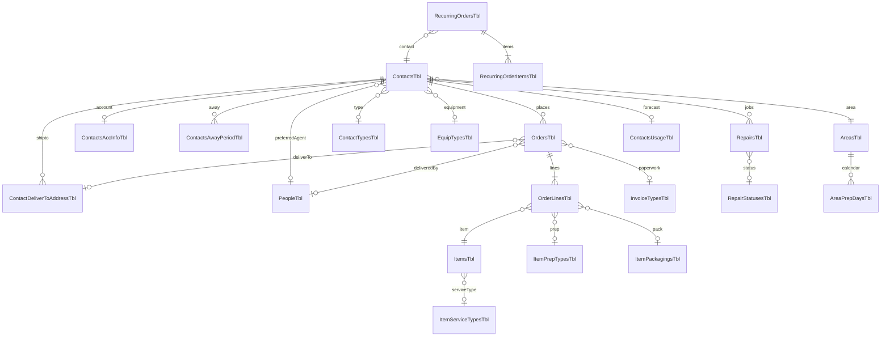
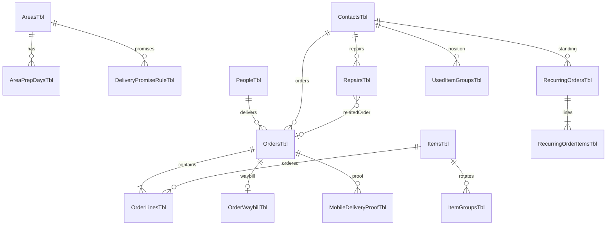

# 05 — Database Analysis

**Catalog:** `OtterDb` (connection `TrackerDataSQL`).  
**Access pattern:** inline SQL in `Repositories\*.cs` and a few pages (`Pages/Lookups.aspx.cs` still has INSERT/UPDATE/DELETE for repair statuses and area prep days).  
**Schema evolution:** XML batches (`App_Data\SQLCommands-*.xml`, `App_Data\GoLive\*.sql`) applied by `Managers\XmlSchemaCommandRunner.cs` and `*SchemaInstaller` classes. Go-live scripts found:

- `00-SystemPreferencesHdrTbl.sql`
- `01-WooCommerceSettingsTbl.sql` through `09-WooPaymentMethodMapTbl.sql`

**Stored procedures:** none are invoked with `CommandType.StoredProcedure` in application code (search of `*.cs`). Business rules live in C#.  
**SQL views and functions:** no `CREATE VIEW` / `CREATE FUNCTION` scripts were found in the repository. **Verify** on the live server (`sys.procedures`, `sys.views`, `sys.objects`) before assuming the database is only tables. If any exist, they are outside source control and are a migration risk.

`Documentation/TABLE_SCHEMA_REFERENCE.md` documents the Access-to-SQL rename and is **not** a full column list for the current database. Prefer `Models\*.cs` and repository SQL. Column names below are the ones the application uses. Types are indicative (INT identity keys, NVARCHAR text, BIT flags, DATETIME2 or DATE — a date-migration note exists at `Documentation/Migration/DATETIME_TO_DATE_MIGRATION_CHECKLIST.md`).

---

## 1. How to read relationships



`ContactsUsageTbl` in current code is the **forecast row** (next coffee, next clean, averages). The Access-era document used that name for delivery events. Actual events are written through `ContactUsageLinesRepository` / `ContactsItemUsageTbl`. **Verify** the physical table name for the forecast (`ContactsUsageTbl` vs `ContactsItemsPredictedTbl`). Both names appear in the codebase because the rename and the later repository layer overlap. RainbowOF should pick one forecast aggregate and one event table and migrate with a column map, not a blind copy of both names.

---

## 2. Tables by business area

### 2.1 Customer

| Table | Purpose | Business meaning | Important relationships |
|---|---|---|---|
| `ContactsTbl` | Customer site | The account the van visits. Company name is the label. Id 9 is walk-in | Area, type, people, equipment, item preferences |
| `ContactsAccInfoTbl` | Commercial profile | PO flag, VAT, bill-to and ship-to lines, terms, limit, price level, bank, registration | Contact, `PaymentTermsTbl`, `PriceLevelsTbl`, `InvoiceTypesTbl` |
| `ContactTypesTbl` | Relationship kind | Contract vs coffee-only vs green-bean vs collection-only | Contacts |
| `ContactsAwayPeriodTbl` | Closed period | Do not remind or assume consumption | Contact, `AwayReasonsTbl` |
| `AwayReasonsTbl` | Reason codes | Holiday, renovation, and similar | Away periods |
| `ContactDeliverToAddressTbl` | Extra ship-to | Delivery on behalf, own GPS | Contact, `AltAddressKindsTbl` |
| `AltAddressKindsTbl` | Ship-to kind | Whether usage at that address counts toward the forecast | Deliver-to |
| `CustomerLocationTbl` | Primary pin | Routing | Contact |
| `ContactChangeLogTbl` | Field audit | Who changed master data | Contact |
| `ContactUserLinkTbl` | Portal login | Membership user ↔ contact | Contact, `aspnet_Users` |
| `ContactPortalSettingsTbl` | Portal options | Feature toggles for My Quaffee | — |
| `ContactPortalChangeRequestTbl` | Requested edits | Customer asks; staff should approve | Contact |
| `QuaffeeLoversGrantTbl` | Loyalty grant | Member invitation state | Contact, Woo customer |
| `SaPostalCodeTbl` | ZA postal reference | Area assignment | Areas |
| `WooPostalAreaMapTbl` | Shop postal → area | Import | Areas |
| `WooContactInfoTbl` | Shop customer link | External id | Contact |

**Legacy names still seen in old classes or SQL strings (do not create these in RainbowOF):** `CustomersTbl`, `CustomerTbl`, `CustomersAwayTbl`, `ClientAwayPeriodTbl`, `customersAccInfoTbl`.

### 2.2 Catalogue

| Table | Purpose | Business meaning |
|---|---|---|
| `ItemsTbl` | Product and service SKU | What can be ordered, including service and note items. Enabled, replacement, unit, units per qty, service type, sort |
| `ItemServiceTypesTbl` | Semantic type | Coffee, clean, filter, group, holiday, swop, green bean |
| `ItemPrepTypesTbl` | How it is prepared | Roast or presentation variant |
| `ItemPackagingsTbl` | Pack | Size, colour, symbol, background on the sheet |
| `ItemUnitsTbl` | Unit of measure | kg, each, and similar |
| `ItemGroupsTbl` | Rotation definition | Ordered set of items treated as one commercial choice |
| `UsedItemGroupsTbl` | Rotation position | Which member this contact received last |
| `ItemSortOrderTbl` | Extra sort keys | Display |
| `TrackedServiceItemsTbl` | Forecast configuration | Which service type writes which usage column, typical average, sets-daily-average flag |
| `ContactTrackedServiceItemsTbl` | Per-contact override | **Verify** vs global tracked items |
| `PriceLevelsTbl` | Named factor | Not a price list |
| `PaymentTermsTbl` | Due rules | Days or day of month |
| `InvoiceTypesTbl` | Paperwork flag | Standard, delivery note, dispatch note; pill label |

### 2.3 Orders and usage

| Table | Purpose | Business meaning |
|---|---|---|
| `OrdersTbl` | Delivery header | Contact, order date, prep date, required-by, delivered-by, confirmed, packed, done, invoice done, notes, PO, invoice type, deliver-to, walk-in area and GPS |
| `OrderLinesTbl` | Lines | Item, qty, prep, packaging |
| `OrderWaybillTbl` | Parcel identity | Tracking number, courier, dispatched at |
| `OrderCheckTbl` | **Verify** | Name suggests a confirmation checklist |
| `RecurringOrdersTbl` | Standing header | Enabled, notes, delivery person, invoice type |
| `RecurringOrderItemsTbl` | Standing lines | Same shape as order lines |
| `RecurringTypesTbl` | Cycle | Weekly / monthly codes |
| `TempOrdersHeaderTbl`, `TempOrdersLinesTbl` | In-progress edit | Session-backed order before commit |
| `TempCoffeecheckupCustomerTbl`, `TempCoffeecheckupItemsTbl` | Checkup working set | Rebuilt each run |
| `ContactsUsageTbl` and/or `ContactsItemsPredictedTbl` | One forecast per contact | Next coffee/clean/filter/descale/service, daily and service averages, last cup count |
| `ContactsItemUsageTbl` | Item events | What was delivered or consumed |
| Usage line table behind `ContactUsageLinesRepository` | Cup-count events | Install date and historical counts. **Verify** physical name (`ContactsUsageTbl` vs a line table) |
| `TotalCountTrackerTbl` | Machine counter | Latest cups |
| `SentRemindersLogTbl` | Checkup log | Success or skip, order type |
| `SendCheckupEmailTextsTbl` | Checkup copy | Editable body |
| `ClientMailTemplatesTbl`, `ClientMailSendLogTbl` | Campaigns | Separate from checkup |

### 2.4 Places, people, calendar

| Table | Purpose | Business meaning |
|---|---|---|
| `AreasTbl` | Delivery zone | Name, short code, sort |
| `AreaPrepDaysTbl` | Zone calendar | Prep weekday, delay days, delivery order |
| `NextPrepDateByArea` / `NextPreperationDateByAreaTbl` | Materialised next dates | Spellings differ in code. **Verify** which table the delivery-days tab updates |
| `DeliveryPromiseRuleTbl` | Website SLA | Window start/end as day-of-week plus minutes, result mode, promise kind, Wednesday rule |
| `HolidayClosuresTbl` | Closed | Extends forecasts. `ClosureDatesTbl` may be the older table. **Verify** which one `HolidayClosureProvider` uses |
| `PeopleTbl` | Humans who deliver or sell | Abbreviation, delivery type, collections flag, normal weekday, `SecurityUsername` |
| `CourierServicesTbl` | Parcel companies | Tracking URL, waybill patterns, default |
| `DeliveryRouteTbl` | Stop sequence for a date | Driver override |
| `DeliveryVisitTbl` | **Verify** | Visit fact, possibly older than proofs |
| `RoadLegTbl` | Travel time between points | Route estimate |
| `GpsSettingsTbl` | Tracking window and depot | With `SystemPreferencesHdrTbl` |
| `DriverLocationPingTbl` | Breadcrumbs | Lat, long, time, source |

### 2.5 Repairs

| Table | Purpose |
|---|---|
| `RepairsTbl` | Job: contact, equipment, serial, fault, status, related order, dates |
| `RepairStatusesTbl` | Status, email flag, sort, note |
| `RepairFaultsTbl` | Fault catalogue |
| `EquipTypesTbl` | Machine model |
| `EquipConditionsTbl` | Condition |

### 2.6 Mobile and proof

| Table | Purpose |
|---|---|
| `MobileDeviceTokensTbl` | SHA-256 of bearer token, person, device, expiry, revoke |
| `MobileDeliveryProofTbl` | Outcome, signature, reason, missing items, POD email timestamp |
| `MobileDeliveryOptionsTbl` | Outcome catalogue |
| `MobileSyncRefTbl` | Client reference de-duplication |
| `MobileApiRequestLogTbl` | Call log, no bodies |
| `MobileApiSettingsTbl` | Single row (SettingsID = 1): auto-complete, terms, tracking, route physics |

### 2.7 Channel

| Table | Purpose |
|---|---|
| `WooCommerceSettingsTbl` | Shop URL, encrypted keys, tracking-required flag |
| `WooItemMappingsTbl` | SKU link |
| `WooAttributeParentTbl`, `WooAttributeMapTbl` | Attribute → qty / pack / notes |
| `WooCategoryFilterTbl` | What may import |
| `WooPackagingServiceTypeTbl` | Pack map |
| `WooAreaDeliveryDefaultTbl` | Default person per area for the shop |
| `WooShippingMethodMapTbl` | Method → area |
| `WooPaymentMethodMapTbl` | Method label |
| `WooOrderInfoTbl` | Imported Woo order id |
| `WooCatalogCacheTbl` | Cached shop catalogue |
| `WooContactInfoTbl` | Already listed under customer |

### 2.8 Platform

| Table | Purpose |
|---|---|
| `LogTbl` | Application log |
| `SysDataTbl` | Legacy key/value configuration. **Verify** what is still read versus `SystemPreferencesHdrTbl` |
| `SystemPreferencesHdrTbl` | Newer preferences header |
| `aspnet_*` | Membership and roles. Not named `*Tbl` in repositories. **Verify** schema `dbo` |
| `UsersTbl` | Name appears in code search. **Suspected** legacy duplicate of membership. Do not migrate both without a row count |
| `GeoApiUsageTbl` | Daily call counts per geocoding service. `GpsSettingsRepository` increments `Calls` and can cap them |
| `SectionTypesTbl` | Log section labels (`SectionID`, `SectionType`, `Notes`). Used by `Pages/LogTable.aspx.cs`. Access-style DDL still sits in `Classes/TrackerDb.cs` |
| `TransactionTypesTbl` | Log transaction labels, same legacy pattern as section types |

### 2.9 Names that are code artefacts, not tables

A full scan of `*Tbl` tokens in C# also returns old Access names (`CustomersTbl`, `CityTbl`, `CityPrepDaysTbl`, `ItemTypeTbl`, `PackagingTbl`, `PersonsTbl`, `ReoccuringOrderTbl`) and control or method prefixes (`GetCustomersTbl`, `AddOrdersTbl`, `odsOrdersTbl`, `PK_CourierServicesTbl`, `ShouldSerializeAreaTbl`). Do not create those in RainbowOF. `DeliveryMethodTbl` appears only in the developer page `test/ShowTableStruct.aspx.cs`. Confirm on the server before treating it as live.

The table-name scan also returned method and control prefixes (`GetCustomersTbl`, `AddOrdersTbl`, `odsOrdersTbl`, `PK_CourierServicesTbl`, `ShouldSerializeAreaTbl`). Ignore those. They are not relations.

---

## 3. Column-level notes that change design

**`OrdersTbl` (from `Models/Order.cs` and `OrderHeaderData`):** `OrderID`, `ContactID`, `OrderDate`, `PrepDate`, `RequiredByDate`, `ToBeDeliveredByID`, `Confirmed`, `Done`, `Packed`, `Notes`, `PurchaseOrder`, `InvoiceDone`, `InvoiceTypeID`, `DeliverToAddressID`, `WalkInAreaID`, `WalkInLatitude`, `WalkInLongitude`. Further flag columns were added by `OrderFlagsSchemaInstaller` (recurring origin and sheet icons). **Read that installer** before generating EF entities so the flag columns are not missed.

**`OrderLinesTbl`:** `OrderLineID`, `OrderID`, `ItemID`, `QtyOrdered`, `PrepTypeID`, `PackagingID`.

**`ContactsTbl` (from `Models/Contact.cs`):** identity and communication columns; `AreaID`; `ContractNo`; `ContactTypeID`; `EquipTypeID`; preference item ids and quantities; `PreferredAgentID`; `PreferredCourierServiceID`; `SalesAgentID`; `EquipentSN`; flags `UsesFilter`, `AutoFulfill`, `Enabled`, `PredictionDisabled`, `AlwaysSendChkUp`, `NormallyResponds`, `SendDeliveryConfirmation`, `DeliveryOnBehalf`; `ReminderCount`; `LastDateSentReminder`; `Notes`. The schema reference’s shorter column list is obsolete.

**`ContactsAccInfo`:** see `Models/ContactsAccInfo.cs`. Includes `RequiresPurchOrder`, VAT, five bill lines, five ship lines, account emails and names, `PaymentTermID`, `Limit`, `PriceLevelID`, `InvoiceTypeID`, `RegNo`, `BankAccNo`, `BankBranch`.

**Forecast fields written by `PredictionManager`:** `NextCoffeeBy`, `NextCleanOn`, `NextFilterEst`, `NextDescaleEst`, `NextServiceEst`, `DailyConsumption`, `CleanAveCount`, `FilterAveCount`, `DescaleAveCount`, `ServiceAveCount`, `LastCupCount`. The target columns for each tracked item are **data** (`UsageDateFieldName`, `UsageAveFieldName`), not fixed in the manager. That is dynamic SQL or a switch. **Read `ApplyField` in `PredictionManager`** before porting; a generic RainbowOF model should replace “column name in a row” with a child table of forecasts per service type.

---

## 4. Stored procedures, views, functions

| Object kind | In source control | Called from | Business purpose |
|---|---|---|---|
| Stored procedures | Not found | Not called | — |
| Views | Not found | Not found | — |
| Scalar/table functions | Not found | Not found | — |
| XML/SQL installers | `App_Data`, `App_Data/GoLive` | `XmlSchemaCommandRunner`, schema installers on startup for mobile, portal, order flags, contact change log, postal, Woo | Create newer tables idempotently |

**Action for the team:** run the verification queries in section 6 on a copy of production and attach the result to this document. Anything in `sys.procedures` that the app does not call may still be used by SSRS or a DBA job.

---

## 5. ERD — operational core



Mobile tokens point at `PeopleTbl` via `PersonID`, not at `ContactsTbl`. Portal users point at `ContactsTbl`.

---

## 6. Verification queries (read-only)

Run on a restored copy, not on production, if policy requires:

```sql
SELECT name FROM sys.tables ORDER BY name;
SELECT name FROM sys.procedures ORDER BY name;
SELECT name FROM sys.views ORDER BY name;
SELECT name FROM sys.objects WHERE type IN ('FN','TF','IF') ORDER BY name;
SELECT name FROM sys.tables WHERE name LIKE 'aspnet%';
SELECT TOP 20 ContactID, CompanyName FROM dbo.ContactsTbl ORDER BY ContactID;
SELECT ContactTypeID, ContactTypeDesc, DriverCollectionOnly FROM dbo.ContactTypesTbl;
SELECT PersonID, Abbreviation, DeliveryType FROM dbo.PeopleTbl WHERE PersonID IN (3,5,7,10);
```

If a column is missing, the installer for that feature has not been applied on that database. The C# installers are written to add missing columns idempotently; a database that only received the original Access migration will not match `Models/Contact.cs` until those XML batches have run.

---

## 7. Migration implications

1. Do not generate EF entities from `TABLE_SCHEMA_REFERENCE.md`.
2. Do generate them from a production schema script plus a diff against repository SQL.
3. Collapse dual names (`ContactsUsageTbl` vs `ContactsItemsPredictedTbl`, closure tables, next-prep tables) during mapping. Keep both only for the ETL, not in the new model.
4. Replace dynamic forecast column names with `Forecast(ContactId, ServiceKind, NextDate, Average)`.
5. Keep external ids: Woo order, Woo customer, QuickBooks identity if the merge tool stores one (**verify** column).
6. Membership tables move to ASP.NET Identity. Passwords cannot be reused (different hash). Plan a reset.
7. Do not copy `MobileDeviceTokensTbl` hashes into production cutover unless devices must stay signed in. Prefer re-login.
8. Preserve contact id 9’s **behaviour** (walk-in bucket) without preserving the magic number. Use a contact flag `IsWalkInBucket`.
