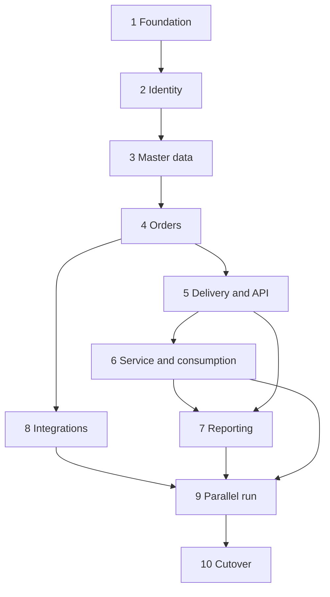

# 12 — Migration Roadmap

**Goal:** RainbowOF on .NET 10, Blazor, MudBlazor, and EF Core replaces QOnT with no loss of business capability, on a product-agnostic model.

**Source of truth for scope:** `docs/09-rainbowof-specification.md`.  
**Do not start from a line-by-line port of `.aspx` files.**

Estimates are relative (S / M / L / XL) for a small team that already knows this domain. They are not calendar commitments.

---

## Phase 1 — Foundation (L)

**Build**

- Solution layout from `docs/11`.
- EF Core schema for customer, product, territory, worker, order, line, standing order — empty of rules is acceptable, shape must match `docs/08`.
- Serilog, OpenTelemetry, health check, `IClock`, options (business time zone, email test mode).
- Blazor shell: drawer from a stub permission set, MudBlazor theme, login page that is not yet the full identity story (a single dev user is enough).
- CI build and test.

**Depends on:** Agreement that the new database is not `OtterDb` live.

**Risk:** Schema churn if phase 3 discovers more contact columns. Mitigation: freeze the entity list against `Models/Contact.cs`, `Order.cs`, `ContactsAccInfo.cs`, and `OrderFlagsSchemaInstaller` before the first migration.

**Exit:** App runs, a developer can sign in, log a line, and see a trace.

---

## Phase 2 — Identity and security (M)

**Build**

- ASP.NET Identity, permissions in `docs/07`.
- User admin screens.
- Portal and staff are the same identity store, different permissions and a `customer_id` claim.
- No anonymous registration.
- Audit of role changes and impersonation.
- Password reset flow.

**Depends on:** Phase 1.

**Risk:** Staff expect their old passwords. They cannot be migrated from `SqlMembershipProvider` hashes. Plan a reset on the weekend of cutover, or a short-lived bridge that validates the old hash once and rewrites Identity (only if the team accepts the extra security review).

**Exit:** An agent cannot open identity admin. A repair-only user cannot open commercial fields. A customer user cannot open staff routes.

---

## Phase 3 — Master data (L)

**Build**

- CRM screens and product screens (`docs/10`).
- Territories, calendars, workers, packs, preparations, document intents, outcomes, closures, promise policies.
- ETL of contacts, account info, areas, people, items, groups, away periods, deliver-to addresses.
- Guest-bucket flag instead of contact id 9, plus a note parser for historical `ZZName` orders.
- Address and GPS.

**Depends on:** Phase 2.

**Risk:** Dual table names and obsolete schema doc. Mitigation: generate the source column list from a restored `OtterDb`, not from `TABLE_SCHEMA_REFERENCE.md`.

**Complexity:** L because of data quality (typos such as `EquipentSN`, missing emails, area-less contacts).

**Exit:** A staff user can find every live customer and the catalogue matches production counts within an explained delta (disabled and test rows).

---

## Phase 4 — Orders (XL)

**Build**

- Order and standing-order use cases, including merge-on-same-date, move line, PO warning, document intent, deliver-to, guest.
- Invitation batch and log, message templates, disable-client links.
- Email send in test mode against a copy of templates.
- ETL of open orders first, then history (decide retention; 48 months matches repair history).

**Depends on:** Phase 3. Also a written answer to the open questions in `docs/04` §12 (auto-fulfil meaning, checkup “yes” behaviour, recurring generator). **Do not guess these in code.**

**Risk:** Standing orders generated twice during parallel run. Mitigation: generator writes an idempotency key `(standingOrderId, requiredDate)`.

**Exit:** UAT script items 2–5 and 11 in `docs/09` §14 pass on migrated data.

---

## Phase 5 — Fulfillment and delivery (XL)

**Build**

- Waves, run sheet, sequence, proof, waybill rules, awaiting-completion queue.
- `/api/v1` compatible with Quaffee Driver (contract tests from `Documentation/MOBILE_API_AND_DRIVER_APP.md`).
- POD PDF and emails.
- GPS under the same window rules.
- Collections / pickup stops.

**Depends on:** Phase 4. Driver app team needs the contract before this phase ends.

**Risk:** Offline sync duplicates. Keep `clientRef` idempotency. Risk: PDF looks different and customers reject it. Capture a golden file from `SimplePdf` during UAT.

**Exit:** A phone on the current driver app completes a stop against a staging RainbowOF, and the office sees awaiting-completion or a moved schedule according to the auto-complete setting.

---

## Phase 6 — Inventory and servicing (L)

**Build**

- Customer on-hand and meter on completion.
- `ConsumptionCalculator` with template defaults (20/30/365, six samples, conversion factor as data).
- Assets (even if most customers migrate as one asset).
- Service tasks, status emails, link to orders.
- Bulk recalculate.
- Pickup stops already delivered in phase 5; warehouse stock stays **off**.

**Depends on:** Phase 5 completion path.

**Risk:** Forecast drift versus QOnT. Mitigation: run both calculators on a copy of 50 customers and diff dates before trusting the port. This is the highest-value test in the programme.

**Exit:** For the sample, next replenishment and next maintenance match, or the delta is explained (holiday table, away, prediction-disabled).

---

## Phase 7 — Reporting (M)

**Build**

- Dashboard counts.
- CSV on wave, run, invitations, import exceptions.
- Log viewer.
- Print CSS for the bench.

**Depends on:** Phases 4–6 so the numbers are real.

**Risk:** Low, as long as nobody adds revenue charts.

**Exit:** Office can run a Monday without printing from QOnT.

---

## Phase 8 — Integrations (L)

**Build**

- Woo connection, maps, idempotent import, programme role push.
- QuickBooks (or current accounts) customer merge as a dry-run import.
- Postal adapter for South Africa.
- External invoice id field only.

**Depends on:** Phase 4 orders. Can start mapping UI during phase 4 if a second developer is free.

**Risk:** Encrypted Woo keys in `OtterDb` cannot be decrypted without `WooCommerceCryptoKey`. Plan a re-entry of keys in the new secret store, not a blind copy of ciphertext.

**Exit:** A staging shop order imports once, maps pack and qty, and lands on the run sheet.

---

## Phase 9 — Parallel run (L)

**Operate**

- RainbowOF reads a nightly copy, then a same-day replica.
- Staff do **one** real day’s work in RainbowOF while QOnT remains the system of record: create the order in both or replay from QOnT until confidence is high. Prefer a single entry point as soon as invitation emails would otherwise send twice.
- Turn email test mode **off** only for a named allow-list, then for all.
- Driver app pointed at staging for one route, then all routes.
- Diff: orders due, proofs, schedules, invitation candidates.

**Depends on:** Phases 2–8.

**Risk:** Two emails to the same customer. Mitigation: only one system has test mode off. Risk: staff edit the wrong system. Mitigation: banner on QOnT (“read only from &lt;date&gt;”) when that flag exists; until then, process discipline.

**Exit:** Five consecutive business days with no unexplained difference in due orders, proofs, or forecasts.

---

## Phase 10 — Production cutover (M)

**Sequence**

1. Freeze QOnT writes (maintenance banner).
2. Final ETL of orders, proofs, schedules, standing orders, tokens **not** copied (drivers sign in again).
3. Identity: users created, passwords reset (or one-time hash bridge).
4. DNS or host switch of the staff URL and the driver base URL.
5. Woo keys entered. Import checkpoint set to the last Woo id in QOnT so old orders are not pulled again.
6. Disable-client secret: new secret, accept that old email links die, or verify the old secret once in the new app for the overlap period.
7. Keep `OtterDb` read-only for one full replenishment cycle (at least a month; busy weekly customers need less, monthly contracts need the longer window).
8. Decommission QOnT only after the acceptance list in `docs/09` §14 has passed on production data.

**Rollback:** Host DNS back to QOnT if the final ETL is still reversible (no writes to QOnT after freeze). Do not allow dual writes.

---

## Suggested implementation order (summary)

Foundation → Identity → Master data → Orders and invitations → Delivery and driver API → Meters and service → Reports → Woo and accounts import → Parallel run → Cutover.

Purchasing, warehouse stock, and a real price engine are **after** cutover. They are not on the critical path.

---

## Dependency sketch

---

## Risk register

| Risk | Impact | Mitigation |
|---|---|---|
| Forecast port does not match `PredictionManager` | Wrong coffee roasted | Diff harness on 50 customers before phase 6 exit |
| Open business questions in `docs/04` §12 answered by developers | Wrong orders emailed | Block phase 4 exit on written answers |
| Role-name bugs copied forward | Agents become admins | New permission table; do not copy role strings as the model |
| Public order links are guessable | Data leak | Confirm `PublicOrderViewManager` before rebuilding; default to signed expiring tokens |
| `Register.aspx` open on production | Account spam | Do not port it |
| Secrets in config samples | Repo exposure | Vault; the current `Web.config` is local-only and must not be copied into docs or git |
| Driver contract drift | Vans stop | Contract tests; keep `/api/v1` shapes |
| Woo ciphertext not portable | Shop orders stop | Re-enter keys |
| Two generators during parallel run | Double deliveries | One email sender live; idempotency keys |
| Lookups page behaviour hidden in code-behind | Missing master data | UAT each `Lookups.aspx` tab against the new settings routes |
| Vineyard/Buiten and Leave and tasting sheet unused but assumed | Wasted scope | Confirm in week 1; if unused, do not build |
| No order-line audit in the old system | Disputes during parallel run | New audit from day one; do not expect history |
| In-memory API throttles | Weakness on multi-instance | Single instance at cutover |

---

## Week-1 verification (human)

1. Live `aspnet_Roles` names and who is in them.
2. Whether checkup acceptance creates an order.
3. Which code path inserts the next standing order.
4. `AutoFulfill` behaviour.
5. Row counts and whether `ClosureDatesTbl` and `ContactsItemsPredictedTbl` are still written.
6. `PublicOrderView` token design.
7. `ViewAs` authorisation.
8. QuickBooks file format.
9. Whether Vineyard/Buiten, Leave, and the tasting sheet are in use.
10. SQL Agent or Task Scheduler jobs on the host.

Until those are answered, the documents mark them as verification items. The rest of the specification is grounded in the pages, managers, models, and tables cited above.

---

## Definition of done

A new team can run RainbowOF for a full Quaffee week: invitations, website orders, preparation, van, meter, forecast, repair, portal, and “stop emailing me”, without opening TrackerSQL except to read an archive order older than the migrated history window.
